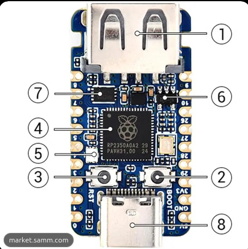

# Hardware, setup, and Cascadia build

## Bench setup

I used an HP 14-cf0xxx laptop running Linux Mint 22.3 Xfce (x86_64, about 4 GB RAM). The target was my iPhone 11 A2111, board N104AP, with an A13/T8030 and iOS 26.5. I chose a RAM-only boot to preserve the phone’s internal storage.



Board reference image, watermarked market.samm.com.

I connected the laptop to the board over USB-C and the iPhone to the board’s USB-A port with a Lightning cable. I copied `usbliter8.waveshare_rp2350_usb_a.uf2` to the board’s bootloader volume, corrected a loose USB-C connection, and checked the device identities on Linux. The board appeared as a Pico at `2e8a:0009` with serial port `/dev/ttyACM0`. On the Cascadia route I moved the phone back to the laptop after the exploit. Its DFU descriptor contained `PWND:[usbliter8]`. [Waveshare board reference](https://www.waveshare.com/wiki/RP2350-USB-A)

## Host setup

I set up Docker 29.1.3 and registered QEMU’s AArch64 handler with binfmt so the x86 laptop could run ARM64 build containers. I checked the handler under `/proc/sys/fs/binfmt_misc/qemu-aarch64` and ran an ARM64 Alpine container. It printed `aarch64`.

```sh
docker run --rm --platform linux/arm64 alpine:3.24 uname -m
```

I used `ipsw` 3.1.714 for image work, `usbliter8ctl` for exploited DFU, and `irecovery` for Recovery commands. I used `./cascadia doctor` to track missing inputs through the build. Once the kernel, bootloader, early filesystem, and packaged image were in place, it reported ready.

## Boot inputs

The first `./cascadia a13 inputs` run downloaded the iOS 16.4 (20E247) inputs and patched iBSS at offset `0x293d8`. It stopped with `error: no IM4M`. I transferred an existing iPhone12,1 SHSH blob to the laptop, extracted its IM4M manifest with `ipsw`, and reran input generation. The manifest passed the chip (`0x8030`), board (`0x04`), and image-type checks. This produced the patched iBSS, DeviceTree, manifest, and empty trust cache in `devices/a13/boot/inputs/`.

These are the two commands I used to clear the missing-manifest error.

```sh
ipsw img4 im4m extract --output devices/a13/boot/inputs/IM4M ~/Desktop/*.shsh2
./cascadia a13 inputs
```

## Cascadia build outputs

These are the components I built with the upstream A13 workflow. The four byte counts below were checked against the local build files.

| Command in the Cascadia checkout | Output |
| --- | --- |
| `./cascadia a13 build m1n1` | Compiled the m1n1 loader and produced `m1n1-idevice.macho` (999,424 bytes). |
| `./cascadia a13 build kernel` | Built `Image.gz` (9,348,343 bytes) and the N104 device tree `t8030-n104.dtb` (14,480 bytes). The exported kernel config selects 16 KB pages. |
| `./cascadia a13 build initramfs` | Produced `initramfs.cpio.gz` (2,859,024 bytes) with BusyBox and Dropbear for early userspace. |
| `./cascadia a13 build rootfs` | Built the Alpine 3.24 root filesystem, archived as `alpine-a13.tar.gz` (about 14 MB). |

I prepared touchscreen firmware and 13 Broadcom BCM4378 firmware files, added an SSH public key, and packaged the images with `./cascadia a13 pack`. The output directory contains the Linux boot image (`m1n1-linux.rkrn.img4`, about 22 MB), a standalone proxy image (`m1n1-proxy.rkrn.img4`, about 385 KB), and the Alpine RAM disk (`alpine.rdsk.img4`, about 14 MB). The phone reached Recovery and accepted the transfers. The next work tested why the expected Linux or proxy interface never appeared. [Firmware and diagnostic payloads](firmware.md)
